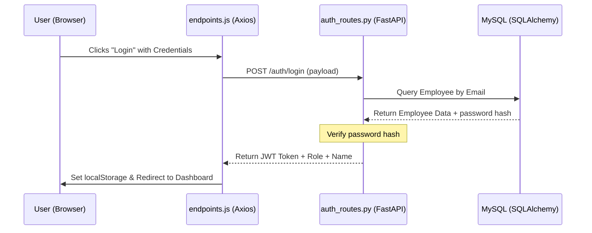
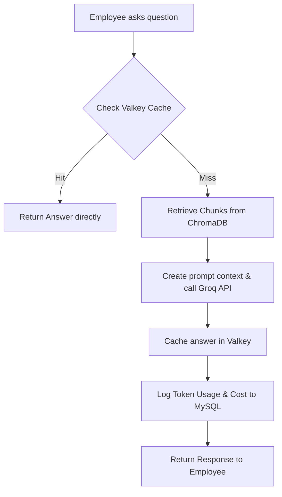

# Project Guide & Developer Documentation

This document provides an easy-to-understand explanation of the AI-HRMS project's architecture, technology stack, directory structure, files, workflows, and API interaction flows.

---

## 1. Project Overview & Tech Stack

This project is a full-stack **Human Resource Management System (HRMS)** with face-recognition attendance tracking and AI-powered capabilities (RAG policy search & administrative assistant).

### Technology Stack
*   **Frontend**: React (Vite), Tailwind CSS (for modern UI layout), Axios (HTTP Client), Recharts (for GenAI Cost visualization).
*   **Backend**: FastAPI (Python), SQLAlchemy (ORM), Pydantic (Request/Response validation), Uvicorn (ASGI Web Server).
*   **Database**: MySQL (relational database for employee, leave, salary, and logs data).
*   **Vector Database**: ChromaDB (stores policy document embeddings locally).
*   **LLM Inference**: Groq Cloud API (fast execution of LLM models for Chatbot and Admin Agent).
*   **Cache Layer**: Valkey / Redis (caches RAG answers to minimize API costs).
*   **Computer Vision**: OpenCV (DNN detector) & Dlib (face recognition / landmark matching).

---

## 2. Directory Structure & File Map

Here is the list of key files, why they exist, and how they contribute to the system.

### A. Backend (`attendance-backend/`)

| File Name / Path | Purpose & Explanation |
| :--- | :--- |
| [`app/main.py`](file:///e:/projects/AI-HRMS/attendance-backend/app/main.py) | **App Entrypoint**: Initializes the FastAPI app, configures CORS middleware, registers routers, and starts the scheduler. |
| [`app/config.py`](file:///e:/projects/AI-HRMS/attendance-backend/app/config.py) | **Environment Configuration**: Loads secrets, API keys, database URLs, and token lifetimes from the `.env` file. |
| [`app/database.py`](file:///e:/projects/AI-HRMS/attendance-backend/app/database.py) | **Database Connection**: Configures the SQLAlchemy engine and provides the database session generator (`get_db`) injected into route handlers. |
| [`app/models.py`](file:///e:/projects/AI-HRMS/attendance-backend/app/models.py) | **Database Tables**: Defines ORM models mapping to MySQL tables (`employees`, `attendance`, `leaves`, `salary_slips`, `chat_logs`, etc.). |
| [`app/schemas.py`](file:///e:/projects/AI-HRMS/attendance-backend/app/schemas.py) | **Data Models (Schemas)**: Defines Pydantic classes to validate request payloads (e.g., login credentials) and format API responses. |
| [`app/auth.py`](file:///e:/projects/AI-HRMS/attendance-backend/app/auth.py) | **Authentication Logic**: Handles password hashing, JWT token generation, parsing, validation, and role protection guards. |
| [`app/cache.py`](file:///e:/projects/AI-HRMS/attendance-backend/app/cache.py) | **Valkey Caching**: Manages connections to the Valkey cache to store and retrieve previously answered RAG questions. |
| [`app/rag_utils.py`](file:///e:/projects/AI-HRMS/attendance-backend/app/rag_utils.py) | **RAG Helper Functions**: Handles reading/parsing PDFs, splitting text into chunks, and managing vector indexes in ChromaDB. |
| [`app/groq_client.py`](file:///e:/projects/AI-HRMS/attendance-backend/app/groq_client.py) | **Groq API Wrapper**: Constructs prompts and calls Groq models to answer employee policy questions using relevant retrieved context. |
| [`app/admin_agent.py`](file:///e:/projects/AI-HRMS/attendance-backend/app/admin_agent.py) | **AI Admin Agent**: Runs the tool-calling loop. When an admin asks a question, the agent figures out which local tools to call. |
| [`app/admin_agent_tools.py`](file:///e:/projects/AI-HRMS/attendance-backend/app/admin_agent_tools.py) | **Admin Agent Tools**: Python functions providing direct, secure queries into MySQL (e.g. counts, attendance lists) for the agent. |
| [`app/scheduler.py`](file:///e:/projects/AI-HRMS/attendance-backend/app/scheduler.py) | **Cron Scheduler**: Automates backend tasks (like daily attendance checks and automatic checkouts). |

#### Routers (`app/routers/`)
*   [`auth_routes.py`](file:///e:/projects/AI-HRMS/attendance-backend/app/routers/auth_routes.py): Handles `/auth/login` and `/auth/register`.
*   [`admin_routes.py`](file:///e:/projects/AI-HRMS/attendance-backend/app/routers/admin_routes.py): Managing employees (CRUD) and general admin actions.
*   [`attendance_routes.py`](file:///e:/projects/AI-HRMS/attendance-backend/app/routers/attendance_routes.py): Standard Check-In, Check-Out, and historical logs.
*   [`leave_routes.py`](file:///e:/projects/AI-HRMS/attendance-backend/app/routers/leave_routes.py): Leave applications, approval and rejection.
*   [`salary_routes.py`](file:///e:/projects/AI-HRMS/attendance-backend/app/routers/salary_routes.py): Monthly salary calculation based on attendance tracking.
*   [`face_attendance_routes.py`](file:///e:/projects/AI-HRMS/attendance-backend/app/routers/face_attendance_routes.py): Special endpoints utilized by the face recognition client to identify matching faces.
*   [`rag_routes.py`](file:///e:/projects/AI-HRMS/attendance-backend/app/routers/rag_routes.py): Endpoints to upload policies, list files, and trigger RAG queries.
*   [`admin_agent_routes.py`](file:///e:/projects/AI-HRMS/attendance-backend/app/routers/admin_agent_routes.py): Interface endpoint for the Admin Chatbot.
*   [`cost_tracker_routes.py`](file:///e:/projects/AI-HRMS/attendance-backend/app/routers/cost_tracker_routes.py): Cost summaries and logs database queries for tracking API expenses.

---

### B. Frontend (`attendance-frontend/`)

| File Name / Path | Purpose & Explanation |
| :--- | :--- |
| [`src/api/client.js`](file:///e:/projects/AI-HRMS/attendance-frontend/src/api/client.js) | **Axios Client**: Defines backend base URL (`http://127.0.0.1:8000`), sets up request interceptors to automatically attach the JWT token, and response interceptors to handle `401 Unauthorized` logouts. |
| [`src/api/endpoints.js`](file:///e:/projects/AI-HRMS/attendance-frontend/src/api/endpoints.js) | **API Declarations**: Declares reusable JavaScript functions matching the FastAPI backend endpoints (e.g. `login`, `applyLeave`, `askHrPolicy`). |
| [`src/context/AuthContext.jsx`](file:///e:/projects/AI-HRMS/attendance-frontend/src/context/AuthContext.jsx) | **Auth State Provider**: Keeps track of whether the user is logged in, their name, role (`admin` or `employee`), and token globally. |
| **Pages (`src/pages/`)** | Individual screens for logging in, viewing dashboard stats, handling leaves, chatting with RAG / Agent, and checking costs. |

---

### C. Face Recognition Client (`face-recognition-client/`)

| File Name / Path | Purpose & Explanation |
| :--- | :--- |
| [`main_attendance.py`](file:///e:/projects/AI-HRMS/attendance-backend/face_recognition/main_attendance.py) | **Edge Capture App**: Captures webcam stream. Detects faces, calculates face embeddings using Dlib, and queries the backend `/face-attendance` endpoint to record a matching employee's check-in or checkout status. |

---

## 3. Workflows & API Calling Process

### A. User Authentication (Login)

1.  **Frontend Action**: The user enters their email and password in `Login.jsx` and submits the form.
2.  **API Call**: `Login.jsx` calls `login(email, password)` from [`src/api/endpoints.js`](file:///e:/projects/AI-HRMS/attendance-frontend/src/api/endpoints.js). This sends a `POST` request to `http://127.0.0.1:8000/auth/login`.
3.  **Backend Processing**:
    *   `auth_routes.py` receives the request payload validated by the `LoginRequest` Pydantic schema.
    *   It queries MySQL via SQLAlchemy to find the employee by email.
    *   It uses `bcrypt` to compare the submitted password against the database's hashed password.
    *   If correct, it generates a JWT containing the `employee_id` and `role`.
4.  **Response**: The backend returns a status `200 OK` with the access token, role, and username.
5.  **Frontend Handler**: The frontend stores the token in `localStorage`, updates the global `AuthContext`, and redirects the user to `/admin` or `/employee` based on their role.

---

### B. HR Policy Chat (RAG Workflow)

Used by employees to query internal policies (leave rules, insurance details) in natural language.

1.  **Frontend Action**: Employee types a query (e.g., "How many annual leaves do I get?") in the Policy Chat tab.
2.  **API Call**: The frontend calls `askHrPolicy(question)`, which sends a `POST /hr-policy/ask` request.
3.  **Backend Processing**:
    *   **Cache Check**: The backend queries Valkey (`cache.py`) to check if this exact question was asked recently. If it is cached (Cache Hit), the answer is returned instantly (0 token cost).
    *   **ChromaDB Search**: If it's a Cache Miss, the backend converts the query into an embedding vector, searches the ChromaDB vector database, and pulls the top matching policy document chunks.
    *   **LLM Inference**: The backend constructs a prompt context containing these text chunks and passes it to Groq's LLM (`openai/gpt-oss-120b`).
    *   **Cost Logging**: The tokens consumed are recorded, the cost is calculated, and it is saved in the MySQL `chat_logs` table. The answer is also written to Valkey with a Time-To-Live (TTL) of 1 hour.
4.  **Response**: The natural language answer is returned to the user.

---

### C. Admin Agent Workflow (Tool-Calling)

Used by admins to query internal HR metrics ("Who is absent today?", "Show me pending leave requests") using natural language.

1.  **Frontend Action**: Admin asks the assistant a question.
2.  **API Call**: Frontend sends a `POST /admin/agent/ask` request.
3.  **Backend Processing**:
    *   FastAPI triggers the `run_agent_loop` in [`app/admin_agent.py`](file:///e:/projects/AI-HRMS/attendance-backend/app/admin_agent.py).
    *   The prompt is passed to Groq along with descriptions of the **4 available tools** (defined in [`app/admin_agent_tools.py`](file:///e:/projects/AI-HRMS/attendance-backend/app/admin_agent_tools.py)):
        1.  `get_attendance_summary`
        2.  `get_employee_attendance`
        3.  `get_pending_leaves`
        4.  `get_salary_info`
    *   The LLM determines which tool to execute (e.g. `get_pending_leaves`) and returns a tool call request.
    *   The backend runs the Python tool locally, querying MySQL safely with parameterized values.
    *   The database results are returned to the LLM.
    *   The LLM parses the raw data into a clean, human-readable paragraph.
    *   The token cost is calculated and saved in the database.
4.  **Response**: The user receives the structured summary.

---

### D. Face Recognition Attendance Workflow

1.  **Client Application**: The webcam client application (`main_attendance.py`) captures video frames.
2.  **Detection & Feature Matching**:
    *   Locates faces using an OpenCV DNN model.
    *   Computes a 128-dimensional vector (embedding) for the face using a Dlib pre-trained model.
3.  **API Call**: The client sends the face embedding vector to `POST /face-attendance/verify`.
4.  **Backend Verification**:
    *   Matches the face embedding against stored employee face templates in the database.
    *   If matched, records a check-in or checkout entry in the MySQL `attendance` table.
5.  **Response**: Returns the status (success/failure) and the matched employee's name to the webcam window overlay.
